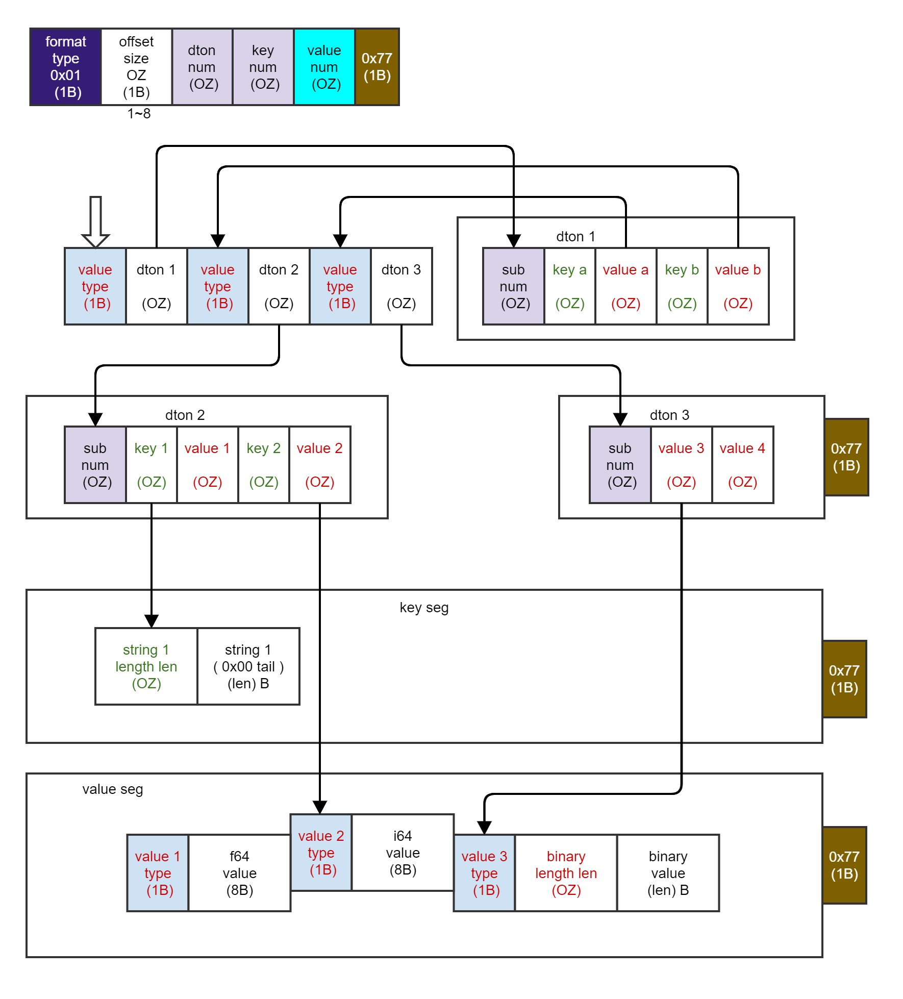

# smdton

Data Tree Object Notation: build binary data trees, read typed values, and apply root-level updates.



## Public API

The source modules below are private Rust modules. Their supported types are re-exported at the crate root; import them with `use smdton::{SmDtonBuilder, SmDtonReader, ST};`.

Signatures below omit the receiver (`&self` or `&mut self`). `JsonValue` means `json::JsonValue`, and `HashMap` means `std::collections::HashMap`. The lifetime `'a` ties builders and readers to borrowed input data.

Node IDs (`oid`) are one-based; the first node is the root (`1`). Child indices are zero-based. A value offset (`value_off`) is a byte offset in the binary buffer. Typed getters require the stored type to match; they do not perform numeric conversions. Readers expect a valid, complete DTON buffer.

## sd_builder - SmDtonBuilder<'a>

Build nested Map and Array nodes. Use `add_*` for Map fields and `push_*` for Array elements. Create child nodes before attaching them to a parent. Borrowed keys, strings, binary data, and JSON input must remain valid while used by the builder.

| Function | Description |
| --- | --- |
| `new() -> Self` | Create an empty builder. |
| `new_from_json(jsn: &'a JsonValue) -> Self` | Build a tree from a JSON object or array. JSON null values are skipped. |
| `create_node(smdt: u8) -> usize` | Create a node using `ST::SMDT_MAP` or `ST::SMDT_ARR`; return its ID. |
| `add_from_json(oid: usize, key: &'a str, jsn: &'a JsonValue)` | Import a JSON value into an existing node. An empty key selects Array-style insertion for ordinary values; use nonempty keys for Map fields. |
| `add_node(oid: usize, key: &'a str, new_oid: usize)` | Attach an existing child node to a Map. |
| `push_node(oid: usize, new_oid: usize)` | Append an existing child node to an Array. |
| `build() -> SmDtonBuffer` | Serialize the current tree into an owned buffer. |

### Map field functions

| Function | Description |
| --- | --- |
| `add_bool(oid: usize, key: &'a str, value: bool)` | Add a `bool` field. |
| `add_u8(oid: usize, key: &'a str, value: u8)` | Add a `u8` field. |
| `add_i16(oid: usize, key: &'a str, value: i16)` | Add a `i16` field. |
| `add_u16(oid: usize, key: &'a str, value: u16)` | Add a `u16` field. |
| `add_i32(oid: usize, key: &'a str, value: i32)` | Add a `i32` field. |
| `add_u32(oid: usize, key: &'a str, value: u32)` | Add a `u32` field. |
| `add_f32(oid: usize, key: &'a str, value: f32)` | Add a `f32` field. |
| `add_i64(oid: usize, key: &'a str, value: i64)` | Add a `i64` field. |
| `add_u64(oid: usize, key: &'a str, value: u64)` | Add a `u64` field. |
| `add_f64(oid: usize, key: &'a str, value: f64)` | Add a `f64` field. |
| `add_string(oid: usize, key: &'a str, value: &'a str)` | Add a `&'a str` field. |
| `add_bin(oid: usize, key: &'a str, value: &'a [u8])` | Add a `&'a [u8]` field. |
| `add_base64(oid: usize, key: &'a str, value: &'a str)` | Decode a `$B64$`-prefixed Base64 string and store binary data. |

### Array element functions

| Function | Description |
| --- | --- |
| `push_bool(oid: usize, value: bool)` | Append a `bool` element. |
| `push_u8(oid: usize, value: u8)` | Append a `u8` element. |
| `push_i16(oid: usize, value: i16)` | Append a `i16` element. |
| `push_u16(oid: usize, value: u16)` | Append a `u16` element. |
| `push_i32(oid: usize, value: i32)` | Append a `i32` element. |
| `push_u32(oid: usize, value: u32)` | Append a `u32` element. |
| `push_f32(oid: usize, value: f32)` | Append a `f32` element. |
| `push_i64(oid: usize, value: i64)` | Append a `i64` element. |
| `push_u64(oid: usize, value: u64)` | Append a `u64` element. |
| `push_f64(oid: usize, value: f64)` | Append a `f64` element. |
| `push_string(oid: usize, value: &'a str)` | Append a `&'a str` element. |
| `push_bin(oid: usize, value: &'a [u8])` | Append a `&'a [u8]` element. |

There is no public `push_base64` function. Decode the data and use `push_bin` when appending binary data manually.

## sd_map - SmDtonMap<'a>

Build a flat Map containing typed scalar values and binary data. Use `SmDtonBuilder` for nested Maps and Arrays.

| Function | Description |
| --- | --- |
| `new() -> Self` | Create an empty Map. |
| `add_from_json(jsn: &'a JsonValue)` | Import supported scalar fields from a JSON object. Nested objects, arrays, and null values are skipped. |
| `build() -> SmDtonBuffer` | Serialize the Map into an owned buffer. |

| Function | Description |
| --- | --- |
| `add_bool(key: &'a str, value: bool)` | Add a `bool` field. |
| `add_u8(key: &'a str, value: u8)` | Add a `u8` field. |
| `add_i16(key: &'a str, value: i16)` | Add a `i16` field. |
| `add_u16(key: &'a str, value: u16)` | Add a `u16` field. |
| `add_i32(key: &'a str, value: i32)` | Add a `i32` field. |
| `add_u32(key: &'a str, value: u32)` | Add a `u32` field. |
| `add_f32(key: &'a str, value: f32)` | Add a `f32` field. |
| `add_i64(key: &'a str, value: i64)` | Add a `i64` field. |
| `add_u64(key: &'a str, value: u64)` | Add a `u64` field. |
| `add_f64(key: &'a str, value: f64)` | Add a `f64` field. |
| `add_string(key: &'a str, value: &'a str)` | Add a `&'a str` field. |
| `add_bin(key: &'a str, value: &'a [u8])` | Add a `&'a [u8]` field. |
| `add_base64(key: &'a str, value: &'a str)` | Decode a `$B64$`-prefixed Base64 string and store binary data. |

## sd_reader - SmDtonReader<'a>

Read nodes and typed values directly from a borrowed binary buffer. Strings and binary slices returned by this reader borrow the underlying buffer.

| Function | Description |
| --- | --- |
| `new(u8a: &'a [u8]) -> Self` | Create a reader over an existing DTON buffer. |
| `clone() -> Self` | Create another reader borrowing the same buffer. |
| `get_int(offset: usize) -> usize` | Read an unsigned offset-sized integer using the buffer header width. |
| `get_field_voff(oid: usize, key: &str) -> usize` | Find a field value offset; return `0` when not found. |
| `get_sub_voff(oid: usize, index: usize) -> usize` | Find a child value offset; return `0` for an invalid node or index. |
| `node_type(oid: usize) -> u8` | Return the node type, or `0` for an invalid node ID. |
| `node_sub_num(oid: usize) -> usize` | Return the number of entries, or `0` for an invalid node ID. |
| `get_sub_key(oid: usize, index: usize) -> Option<String>` | Return an owned Map key at the given index. |
| `get_sub_map(oid: usize) -> HashMap<String, usize>` | Return Map keys and value offsets; return an empty map for an invalid node or a non-Map node. |
| `to_json(oid: usize) -> Option<JsonValue>` | Convert a supported node and its descendants to a JSON tree. |
| `get_type_by_voff(value_off: usize) -> Option<u8>` | Read the stored type tag at a valid value offset. |

### Typed getter functions

Each row lists the field-key, child-index, and byte-offset forms. Their signatures are:

```rust
get_*(oid: usize, key: &str) -> Option<T>
get_*_by_id(oid: usize, index: usize) -> Option<T>
get_*_by_voff(value_off: usize) -> Option<T>
```

| By field key | By child index | By value offset | T |
| --- | --- | --- | --- |
| `get_bool` | `get_bool_by_id` | `get_bool_by_voff` | `bool` |
| `get_u8` | `get_u8_by_id` | `get_u8_by_voff` | `u8` |
| `get_i16` | `get_i16_by_id` | `get_i16_by_voff` | `i16` |
| `get_u16` | `get_u16_by_id` | `get_u16_by_voff` | `u16` |
| `get_i32` | `get_i32_by_id` | `get_i32_by_voff` | `i32` |
| `get_u32` | `get_u32_by_id` | `get_u32_by_voff` | `u32` |
| `get_f32` | `get_f32_by_id` | `get_f32_by_voff` | `f32` |
| `get_i64` | `get_i64_by_id` | `get_i64_by_voff` | `i64` |
| `get_u64` | `get_u64_by_id` | `get_u64_by_voff` | `u64` |
| `get_f64` | `get_f64_by_id` | `get_f64_by_voff` | `f64` |
| `get_string` | `get_string_by_id` | `get_string_by_voff` | `&str` |
| `get_bin` | `get_bin_by_id` | `get_bin_by_voff` | `&[u8]` |
| `get_node_id` | `get_node_id_by_id` | `get_node_id_by_voff` | `usize` |

The `get_node_id*` functions return references to Map or Array nodes as node IDs. `Option` does not make arbitrary byte offsets safe: malformed buffers and out-of-range offsets can panic.

## sd_dton - SmDton<'a>

Read root Map fields through an original buffer and an optional update buffer. Typed getters try the update first and fall back to the original when the update does not yield a value of the requested type. Updates replace the current update layer rather than accumulating a history.

| Function | Description |
| --- | --- |
| `new_from_buffer(smb: &'a SmDtonBuffer) -> Self` | Create a view over a buffer; an empty buffer creates an empty view. |
| `new_from_pair(pair: &'a SmDtonPair) -> Self` | Create a view over original and update buffers. If the original buffer is empty, the constructor creates an empty view. |
| `update(vec: &'a [u8])` | Replace the update layer with a borrowed DTON buffer. |
| `update_by_dton(ndt: &SmDton<'a>)` | Use the other view's original reader as the update layer, when this view has an original reader. |
| `stringify() -> Option<String>` | Serialize the root with shallow field updates. Original-only output is pretty-printed with four-space indentation; a valid update produces compact output. |
| `combine<'b>(ndt: &SmDton<'a>) -> Option<JsonValue>` | Return a shallow merge of both views as JSON; fields from `ndt` take precedence. |
| `clone() -> Self` | Clone the view over its borrowed buffers. The current implementation clones readers only when an original reader is present. |

| Function | Description |
| --- | --- |
| `get_bool(key: &str) -> Option<bool>` | Read a typed root field. |
| `get_u8(key: &str) -> Option<u8>` | Read a typed root field. |
| `get_i16(key: &str) -> Option<i16>` | Read a typed root field. |
| `get_u16(key: &str) -> Option<u16>` | Read a typed root field. |
| `get_i32(key: &str) -> Option<i32>` | Read a typed root field. |
| `get_u32(key: &str) -> Option<u32>` | Read a typed root field. |
| `get_f32(key: &str) -> Option<f32>` | Read a typed root field. |
| `get_i64(key: &str) -> Option<i64>` | Read a typed root field. |
| `get_u64(key: &str) -> Option<u64>` | Read a typed root field. |
| `get_f64(key: &str) -> Option<f64>` | Read a typed root field. |
| `get_string(key: &str) -> Option<String>` | Read a typed root field. |
| `get_bin(key: &str) -> Option<&[u8]>` | Read a typed root field. |

`get_string` returns an owned string; `get_bin` returns a borrowed slice. Shallow merges replace a nested field as a whole rather than recursively merging its children.

## sd_buffer - SmDtonBuffer

Own serialized bytes. Public fields: `buf: Vec<u8>` and `off: usize` (the write cursor).

| Function | Description |
| --- | --- |
| `new() -> Self` | Create an empty buffer. |
| `get_buffer() -> &[u8]` | Borrow the serialized bytes. |
| `is_empty() -> bool` | Check whether the byte vector is empty. |
| `stringify() -> Option<String>` | Serialize the root as JSON using `SmDton`. |
| `clone() -> Self` | Clone the buffer and cursor through the derived `Clone` implementation. |

### Low-level buffer functions

These methods are public serialization helpers. The caller must provide correct sizes, offsets, and initialized buffer contents. Prefer `SmDtonBuilder` or `SmDtonMap` for normal construction.

| Function | Description |
| --- | --- |
| `build_start(size: usize, oz: usize)` | Allocate the buffer and start its header; `oz` is an offset width of `1`, `2`, or `4` bytes. |
| `build_put_u8(b: u8)` | Write one byte and advance the cursor. |
| `build_put_bin(bytes: &[u8], len: usize)` | Copy `len` bytes and advance the cursor. Source and destination must have sufficient space. |
| `build_put_int(data: usize)` | Write an integer using the header offset width. |
| `calc_key_part<'a>(knum: usize, kseg_off: usize, keys: &Vec<&'a str>) -> Vec<usize>` | Calculate key offsets. |
| `calc_value_part<'a>(vnum: usize, vseg_off: usize, values: &Vec<SmDtonData<'a>>) -> Vec<usize>` | Calculate value offsets; uses an internal data type. |
| `build_kvsegs<'a>(knum: usize, vnum: usize, keys: &Vec<&'a str>, values: &Vec<SmDtonData<'a>>)` | Write the key and value segments; uses an internal data type. |

`SmDtonData` appears in the last two signatures but is not re-exported by the crate. External callers cannot import or construct that type through the public API.

## sd_pair - SmDtonPair

Own an original buffer and its update buffer. Public fields: `raw: SmDtonBuffer` and `update: SmDtonBuffer`.

| Function | Description |
| --- | --- |
| `new(raw: SmDtonBuffer, update: SmDtonBuffer) -> Self` | Take ownership of both buffers. |

## sd_data - ST

`ST` exposes format and type constants. It has no public functions.

| Constant | Value (u8) | Meaning |
| --- | --- | --- |
| `ST::SMTY_DTR` | `0x01` | DTON format |
| `ST::SMDT_MAP` | `0x01` | Map node |
| `ST::SMDT_ARR` | `0x02` | Array node |
| `ST::SMDT_BOO` | `0x11` | Boolean |
| `ST::SMDT_UI8` | `0x12` | Unsigned 8-bit integer |
| `ST::SMDT_I16` | `0x13` | Signed 16-bit integer |
| `ST::SMDT_U16` | `0x14` | Unsigned 16-bit integer |
| `ST::SMDT_I32` | `0x15` | Signed 32-bit integer |
| `ST::SMDT_U32` | `0x16` | Unsigned 32-bit integer |
| `ST::SMDT_F32` | `0x17` | 32-bit float |
| `ST::SMDT_I64` | `0x18` | Signed 64-bit integer |
| `ST::SMDT_U64` | `0x19` | Unsigned 64-bit integer |
| `ST::SMDT_F64` | `0x1a` | 64-bit float |
| `ST::SMDT_STR` | `0x21` | String |
| `ST::SMDT_BIN` | `0x22` | Binary data |
| `ST::SMDT_B64` | `0xB2` | Base64 input marker; serialized as binary data |

`SmDtonData`, `SmDtonNode`, and the `su` utilities are internal implementation types and helpers, and are not exported at the crate root.
